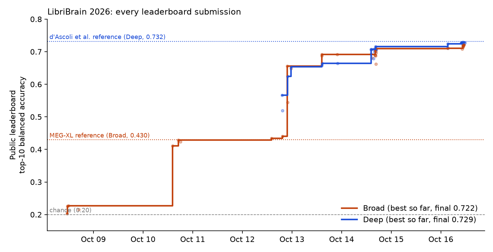

# Decoding heard words from MEG (LibriBrain 2026)

This repository holds the code, the experiment log and the development history of my entry to the PNPL LibriBrain 2026
competition on Kaggle. The task is to identify which of 50 words a listener heard, given 306 channels of
magnetoencephalography recorded while they listened. Scoring is top-10 balanced accuracy, for which chance is 0.20.

The entry finished 8th, with public-leaderboard scores of 0.722 on the Broad track and 0.729 on the Deep track. It uses no
cross-subject or cross-track information about the holdout, a point discussed under [Rules and compliance](#rules-and-compliance)
because several higher entries were flagged by the organisers for exactly that.



| | Broad: 39 subjects, at most 40 min labelled each | Deep: one subject, about 80 h |
|---|---|---|
| Published reference | 0.430, MEG-XL (pretrained on ~300 h from 800 subjects) | 0.732, d'Ascoli et al. (supervised on all subject-0 data) |
| This entry, public leaderboard | 0.722 | 0.729 |
| This entry, private leaderboard | pending | pending |

All training ran on a single RTX 4060 Ti with 8 GB of memory, over 26 days.

## Summary of findings

The largest single gain came from the training target. Training the encoder to predict the contextual
embedding of each heard word, taken from block 12 of the T5-large encoder and fitted with a SigLIP loss, carried Broad from
0.23 to 0.43; transformer depth and window length moved it by a point or two.

The second large step was counterintuitive. A model trained on subject 0 alone and transferred to the Broad subjects with no
adaptation at all scored 0.66, well above every multi-subject recipe tried. Mixing in the Broad subjects' own labelled data
lowered transfer steadily (0.632 locally with none of it, 0.452 when it made up half of each batch), and twenty external MEG
listeners from the Le Petit Prince corpus cost 0.15. The likeliest reading is that ten to forty minutes per subject adds more
inter-subject variance than signal.

The holdout itself has structure that a subject's own unlabelled rows reveal. A bigram hidden Markov model fitted by EM to
one subject's 156 holdout sentences adds 0.018 on Broad, and Sinkhorn balancing of that subject's predicted class mass adds
0.036. Both are computed within a subject. On Deep, re-estimating BatchNorm statistics from the holdout recording day gives
0.044. That is consistent with a holdout recorded on a day absent from training, which the BIDS acquisition dates support;
the same step lowers Broad by 0.011.

What limits the score is the evidence available per word. If one cheats and averages a subject's posteriors over repeated
presentations of the same word, accuracy rises by 0.07 with two repeats, 0.14 with four and 0.22 with sixteen. Without labels
those repeats cannot be found, since the similarity between same-word trials is at chance in each of eight raw-MEG spaces we
examined. The 164 post-processing ideas tested in the last two days of the competition redistribute the existing evidence, and
none of them produced more than a few thousandths.

## Leaderboard history

Each row below is an actual public submission (`results/lb_history/`), and the change is measured from the row above.

Broad:

| Step | Public | Change |
|---|---|---|
| 1 s CNN trained on subject 0, applied zero-shot | 0.203 | |
| Multi-subject trunk with per-subject input layers | 0.225 | +0.022 |
| 3 s windows clipped to the sentence, sentence transformer, T5 SigLIP targets | 0.428 | +0.203 |
| Subject-0-only training, four-layer sentence transformer | 0.655 | +0.227 |
| Per-subject Sinkhorn class balancing, T = 2 | 0.691 | +0.036 |
| Ten seeds | 0.692 | +0.001 |
| Self-learned sentence prior (within-subject bigram HMM, κ = 20) | 0.710 | +0.018 |
| Per-subject input layer fitted on labelled data; temporal-lobe weighting for unlabelled subjects | 0.711 | +0.001 |
| Balancing offsets fitted on sentence rows only, T = 1.75 | 0.721 | +0.010 |
| Unlabelled subjects: average over six donor subjects' input layers, applied to their own MEG | 0.722 | +0.001 |

Deep:

| Step | Public | Change |
|---|---|---|
| Sentence model with T5 targets, subject 0's own input layer | 0.566 | |
| Subject-0-only recipe, five seeds | 0.654 | +0.088 |
| Sinkhorn balancing, T = 3 | 0.664 | +0.010 |
| BatchNorm statistics re-estimated on the holdout day | 0.708 | +0.044 |
| Self-learned sentence prior, κ = 20 | 0.716 | +0.008 |
| Wider encoder (d 192, D 384), five seeds | 0.724 | +0.008 |
| Separate 1 s decoder for the isolated-word rows | 0.727 | +0.003 |
| Balancing offsets fitted on sentence rows only, γ = 0.85 | 0.729 | +0.002 |

Some steps lost ground. A trigram language model over text cost 0.11 once the decoder was strong, because a text prior
overrides good brain evidence as readily as bad. An end-of-sentence distribution in the HMM cost 0.013, and using a text
bigram as the HMM's Dirichlet base cost 0.047.

## Method

Continuous MEG is resampled from 250 to 50 Hz with a Kaiser-windowed FIR filter (`scripts/build_cont.py`). Each word is
represented by a 3 s window from one second before onset to two seconds after, zeroed outside the word's own sentence epoch
and accompanied by a validity-mask channel; isolated single-word epochs use [0, 1) s. Windows are normalised over their
valid samples.

The model has about five million parameters. A per-subject 306 × 306 input layer (the identity for unseen subjects) feeds a
convolutional word encoder: a 1 × 1 projection to 128 channels, three residual temporal blocks, two strided convolutions and
a linear map to a 256-dimensional word embedding. A four-layer pre-norm transformer then attends over the words of a
sentence, with timing inputs zeroed. Two heads sit on top, a 50-way classifier and a 1024-dimensional projection trained with
SigLIP against T5-large embeddings of every word in the training audiobooks, about a million of them, vocabulary or not.
The code is in `src/v3lib.py` and `scripts/train_v3.py`.

Inference treats each subject separately (`scripts/predict_holdout_v3.py`, `scripts/hmm_prior.py`). Logits are corrected by
half the log training prior and averaged over seeds. For Deep, BatchNorm statistics are first re-estimated on the subject's
holdout rows. A bigram HMM is then fitted by EM to the subject's holdout sentences, with emissions given by the posterior
divided by the subject's mean posterior and transitions smoothed toward uniform with Dirichlet strength κ = 20, and its
forward-backward marginals replace the posteriors. Finally a Sinkhorn step scales each class toward equal total mass, with
the offsets fitted on sentence rows, at temperature 1.75 for Broad and 3 for Deep.

## Rules and compliance

Every subject heard the same 156 holdout sentences. Absolute onset times and the shuffle seed would therefore allow rows to be
matched across subjects and tracks, and the organisers disqualify any team that does so. Nothing here uses that
correspondence; each test-time computation reads one subject's rows and nothing else.

I also kept a stricter rule of my own and excluded relative word timing as an input. A model given inter-word intervals
improved from 0.30 to 0.51 locally, which says more about the stimulus metadata than about the brain, and the feature was
removed. `docs/COMPLIANCE.md` sets out the audit.

## Negative results

A good part of the work consists of documented nulls, each written down with a predicted effect before it was run. On the
representation side these include T5-3B targets (−0.016 on Broad), wav2vec2 acoustic targets (+0.005), 100 Hz input
(−0.052), wider windows (−0.022), deeper transformers and longer training, none of which helped. Adaptation methods (CORAL,
entropy minimisation, soft pseudo-label self-training on the holdout, fine-tuning of the input layer and head) stayed within
a hundredth of baseline. So did a long list of alternative feature families, among them reservoir computing,
phase-amplitude coupling, topological summaries, neural fields, hyperdimensional codes, hyperbolic embeddings, Riemannian
and DTW features and MEG-XL embeddings.

The post-processing sweeps in the final two days were run against a holdout simulator built from real held-out posteriors
and vocabulary-only sentences (`docs/home_stretch/tuning/simrule.py`). It reproduces the leaderboard gain of the sentence
prior (+0.014 against +0.018), which is why it was trusted for screening, though it ranks the HMM's κ wrongly at low values.

One neurophysiological probe did replicate. Sentence-initial words decode 0.12 to 0.32 better than the same words in
mid-sentence for subjects the model has never seen, an effect that follows the stronger response after silence. It cannot
be used at test time, since it depends on position rather than identity.

## Repository layout

| Path | Contents |
|---|---|
| `src/` | data access (`cont.py`, `common.py`), evaluation splits (`split2.py`), model and training library (`v3lib.py`) |
| `scripts/train_v3.py`, `predict_holdout_v3.py`, `hmm_prior.py` | the final pipeline |
| `scripts/` | all other experiment, probe and queue scripts, kept as they were run |
| `PREDICTIONS.md` | pre-registration log: predictions written before each test, outcomes recorded after |
| `REPORT.md`, `RUNS.md` | running report and run table |
| `docs/home_stretch/` | the final two days: plan, ledger, tuning scripts and the simulator |
| `docs/COMPLIANCE.md` | rules audit |
| `results/lb_history/` | every submission and its public score |

## Reproduction

```bash
python -m venv .venv && source .venv/bin/activate
pip install -r requirements.txt            # pinned versions in requirements-lock.txt
export LIBRIBRAIN_DATA=/path/to/LibriBrain100
export LIBRIBRAIN_HOLDOUT=/path/to/COMPETITION_HOLDOUT
export LIBRIBRAIN_CACHE=/path/to/cache
bash reproduce/run_final.sh             # matches the submitted files up to seed-level noise
```

The data are not included. LibriBrain is distributed by the PNPL group at Oxford, and the holdout through the competition's
Kaggle pages. One training seed took about 40 minutes on the hardware above. With preprocessing and T5 target extraction, the full
reproduction is a matter of hours rather than days.

## How the work was done

Each idea was entered in `PREDICTIONS.md` with an expected effect and a decision threshold before compute was spent on it,
and the outcome was added afterwards, so misses sit in the log beside hits. The git history is left as it happened. The
experiments were carried out with AI coding agents (Claude Code) working under my direction, and the commit trailers record
that.

## License

MIT; see `LICENSE`. The data and the T5 weights keep their own licences.
